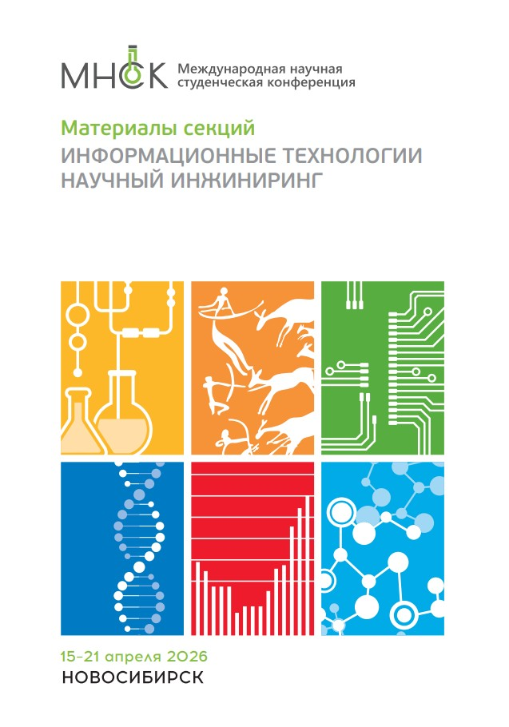

## Цитирование проекта OnSiteSeq

### 📕 Статья в индексе РИНЦ — методология BioMLOps

**Горбенко Р. А.** «Методология управления жизненным циклом машинно-обучаемых моделей в биомедицинских приложениях: исследование на данных о резистентности ВИЧ‑1» // Молодёжь и современные информационные технологии: сборник трудов XXIII Международной научно-практической конференции студентов, аспирантов и молодых учёных (Томск, 18–20 февраля 2026 г.). — Томск: Национальный исследовательский Томский политехнический университет, 2026. — С. 370–375.

✅ **Работа входит в индекс РИНЦ** (eLIBRARY ID: 91848892, EDN: WETXLG).

В этой статье **описан подход BioMLOps** — адаптация методологий MLOps для задач вычислительной биологии. Подход обеспечивает управляемый жизненный цикл моделей: от выбора архитектуры (CNN + Self-Attention) до непрерывного мониторинга метрик на эталонных данных, автоматическое версионирование экспериментов с регрессионным тестированием и пайплайн дообучения при обновлении внешних баз (Stanford HIVDB) с автоматической детекцией деградации качества модели. Эффективность показана на системе HIV‑1‑Resist‑Rus; код и веса моделей открыты на GitVerse.

🔗 [https://www.elibrary.ru/item.asp?id=91848892](https://www.elibrary.ru/item.asp?id=91848892&pff=1)

---

Метод HIV-1-M-Env-Rus опубликован в материалах 64‑й Международной научной студенческой конференции (МНСК‑2026), НГУ, 2026, с. 155.

🔗 [https://www.nsu.ru/n/issc/collection/](https://www.nsu.ru/n/issc/collection/)

---

Горбенко Р. А. «Определение резистентности и классификация субтипов ВИЧ‑1 на ПАК OnSiteSeq» // 68‑я Всероссийская научная конференция МФТИ (секция «Биологическая и медицинская физика»), 2026.

🔗 [https://conf.mipt.ru/page/conference-materials](https://conf.mipt.ru/page/conference-materials)

---

### 🏛 Философия инженерной деятельности — terra nullius медицины будущего

**Горбенко Р. А.** «Автономные диагностические системы с искусственным интеллектом как terra nullius медицины ближайшего будущего» // Свет и тени цифровой реальности: живой интеллект и его аватары: тезисы IV Всероссийской конференции с международным участием (Пермь, ПГНИУ, 26–27 марта 2026 г.). — Пермь: Пермский государственный национальный исследовательский университет, 2026. — С. 162–166.

Работа вышла в секции **«Философия инженерной деятельности: terra nullius инженеров и гуманитариев»**. В ней опыт создания линейки OnSiteSeq осмыслен философски: автономная диагностическая система с ИИ — это не просто инструмент, а **субъект принятия витальных решений**, что порождает «моральную зону деформации» (Moral Crumple Zone, М. Элиш) и вопрос распределения ответственности за ошибку — между разработчиком базовой модели, Medtech-интегратором и врачом. Технологический ответ на кадровый кризис и «медицинские пустыни» отдалённых регионов ставит философские вопросы, на которые у медицины пока нет готовых ответов.

---

### 🌾 Агробиологическая ветка — пирикуляриоз риса в полевых условиях

**Горбенко Р. А.** «Программно-аппаратный комплекс OnSiteSeq для экспресс-диагностики пирикуляриоза риса и фунгицидной резистентности *Pyricularia oryzae* в полевых условиях» // Биотехнологии для пищевой промышленности будущего: платформа для науки и индустрии. Сборник материалов II Всероссийской научно-практической конференции (Москва, 17–18 сентября 2026 г.). — СПб.: Наукоемкие технологии, 2026. — С. 94. ISBN 978-5-00271-196-3.

✅ **Сборник передан в РИНЦ в установленном порядке.**

<strong>Abs — аннотация</strong>

Представлен программно-аппаратный комплекс OnSiteSeq для полевой экспресс-диагностики пирикуляриоза риса. Конвейер <code>onsiteseq_rice</code> работает на Edge-платформе (Nvidia Jetson AGX) и анализирует пять локусов, отвечающих за идентификацию возбудителя и маркеры фунгицидной резистентности. На демонстрационном изоляте достигнуто покрытие до 944×; итоговый отчёт формируется менее чем за 4 часа — без передачи данных в центральную лабораторию.

🔗 [https://bppbconf.ru/archive](https://bppbconf.ru/archive) · 📸 [Страница конференции с фотографиями постерной сессии](/conferences/bppb-2026/)

---

Статья на Хабре: «Как мы разработали ML-модели для определения лекарственной устойчивости и субтипа ВИЧ-1»

🔗 [https://habr.com/ru/companies/mipt_digital/articles/1058460/](https://habr.com/ru/companies/mipt_digital/articles/1058460/)
