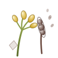

  
  <h1>Пирикуляриоз риса — Magnaporthe oryzae</h1>
  
Полевая детекция пирикуляриоза с профилем Avr-эффекторов и чувствительности к фунгицидам — за часы, прямо на рисовом чеке

---

## 🧬 Описание пайплайна

*Magnaporthe oryzae* (син. *Pyricularia oryzae*) — аскомицет, возбудитель пирикуляриоза — самой разрушительной болезни риса в мире. Ежегодные потери урожая от пирикуляриоза оцениваются в 10–30% — этого зерна хватило бы для пропитания десятков миллионов человек. Китай, крупнейший мировой производитель риса, рассматривает пирикуляриоз как угрозу №1 для рисоводства.

Вид включает несколько патотипов: рисовый патотип (*Oryza*) и патотип *Triticum* — возбудитель «пшеничного взрыва» (wheat blast), появившийся в Южной Америке и занесённый в Бангладеш (2016) и Африку. Дифференциация патотипов критична для карантинного контроля.

Популяция патогена эволюционирует очень быстро: устойчивые сорта риса (с генами **Pi**) «пробиваются» за несколько лет. Поэтому нужен постоянный мониторинг рас и эффекторного репертуара прямо в поле. Гены авирулентности (**Avr**-эффекторы: *Avr-Pita*, *Avr-Pik*, *Avr-Piz-t*, *Avr-Pii* и др.) определяют, какие Pi-гены ещё работают против местной расы. Эффекторные гены часто лежат в субтеломерных районах среди повторов и транспозонов — короткие прочтения их плохо разрешают, тогда как **длинные прочтения ONT дают полную сборку и фазирование** этих локусов.

Наш пайплайн выполняет **таргетное ампликонное нанопоровое секвенирование** поражённых листьев и узлов риса прямо в поле (секвенатор **Нанопорус**, Россия). За один рабочий день агроном получает идентификацию вида, **профиль Avr-эффекторов** (данные для подбора устойчивых сортов) и **профиль чувствительности к фунгицидам** (данные для планирования фунгицидной программы).

* **📥 На входе:** Сырые данные в формате `FASTQ` после High Accuracy basecalling (Dorado SUP, химия R10.4.1). Материал: поражённые листья и узлы риса, гомогенат ткани.
* **📤 На выходе:** Исследовательский HTML-отчёт (RUO) для агронома — вид и патотип возбудителя, профиль Avr-эффекторов, чувствительность к фунгицидам.

---

## 📊 Доступность продукта

| Платформа | Статус доступности |
| :--- | :--- |
| **OnSiteSeq Cockpit Edge** | 🟢 **Реализовано** (демо-прогон 13/13 шагов на ПАК) |
| **OnSiteSeq Cockpit Desktop** | 🟡 **В разработке** |
| **OnSiteSeq Cockpit Cloud** | 🟢 **Доступно** (капсула [CAPS-2026-00016](https://caps.onsiteseq.io/CAPS-2026-00016), образ x86-64) |

---

## 🚀 Статус реализации (ноябрь 2026)

* **Конвейер [onsiteseq_rice](https://gitverse.ru/onsiteseq/onsiteseq_rice)** (Snakemake, Docker arm64) — мультиплексная панель из 5 локусов (cyt_b, CYP51, MoHIK1/Bos1, AVR-Pita, AVR-Co39, ~11,5 Кб): QC → minimap2 → Clair3 → snpEff → агрономический отчёт. Образ в реестре `harbor.onsiteseq.io`, регистрация в каталоге Cockpit.
* **Дообученная модель Clair3** под *P. oryzae* — первая грибная модель для химии R10.4.1/SUP. По независимой оценке (vcfdist): SNP F1 = **0,953** на holdout-изоляте O-219 (базовые модели: 0,930–0,949), INDEL F1 = **0,813** (базовые: 0,272–0,605). Веса — TensorFlow и PyTorch.
* **Капсула [CAPS-2026-00016](https://caps.onsiteseq.io/CAPS-2026-00016)** — модель и воспроизводимая оценка в реестре OnSiteSeq Caps.
* **Публикация**: Горбенко Р.А. // Сборник материалов II Всероссийской научно-практической конференции «Биотехнологии для пищевой промышленности будущего» (Москва, 17–18 сентября 2026 г.), 2026 — сборник передан в РИНЦ. Постер на постерной сессии BPPB-2026.
* **7 репортов об ошибках в Clair3** (HKU-BAL/Clair3 #466–#470, #488, #489), пять из них уже исправлены upstream (релиз v2.0.4).

---

## 🧩 Архитектура пайплайна

1. **QC прочтений** — фильтрация по длине и качеству, отсечение неспецифичных выравниваний.
2. **Выравнивание на ампликоны** — minimap2 только на 5 целевых локусов (~11,5 Кб), а не на полный геном: глубина покрытия ≫1000×.
3. **Вызов вариантов** — Clair3 в гаплоидном режиме, наша дообученная модель `moryzae_finetuned`.
4. **Аннотация** — snpEff с кастомной БД *P. oryzae* 70-15; *cyt_b* — по митохондриальной таблице кодонов.
5. **Интерпретация и отчёт** — маркеры резистентности (G143A, F129L), AVR-профиль расы, QC-отчёт; печать компактного чека на встроенном термопринтере ПАК.

Весь пайплайн реализован на **Snakemake** и поставляется в виде Docker-контейнера через реестр `harbor.onsiteseq.io`.

---

## 🎯 Маркеры устойчивости к фунгицидам

| Ген-мишень | Механизм | Фунгицид (класс) |
| :--- | :--- | :--- |
| **Сциталон-дегидратаза** (биосинтез меланина) | Полиморфизмы мишени | Карбопропамид и др. (MBI-D) |
| **CYP51** (стерол-14α-деметилаза) | Полиморфизмы мишени | Триазолы (DMI: тебуконазол, пропиконазол) |
| **Рибосомальные мишени** | Полиморфизмы мишени | Касугамицин (антибиотик, широко применяется в Азии) |
| **Cytb** (цитохром b) | Мониторинг чувствительности | Стробилурины / QoI (азоксистробин) |

Пайплайн выполняет мониторинг чувствительности к QoI и DMI по данным секвенирования генов-мишеней. QoI-маркеры **G143A** и **F129L** в митохондриальном гене *cyt_b* описаны у *P. oryzae* (Avila-Adame & Köller, 2002); аннотация *cyt_b* ведётся по митохондриальной таблице кодонов (таблица 4 NCBI). Полевые маркеры в гене осмосенсора **Bos1/MoHIK1** для *P. oryzae* не описаны — локус используется для мониторинга, без интерпретации статуса резистентности.

---

## 🌾 Мониторинг рас и Avr-эффекторов

| Ген авирулентности | Соответствующий ген устойчивости риса | Практическое значение |
| :--- | :--- | :--- |
| **Avr-Pita** | Pi-ta | Потеря аллели Avr-Pita → сорта с Pi-ta теряют устойчивость |
| **Avr-Pik** | Pik | Аллельная серия Avr-Pik определяет спектр работающих Pik-аллелей |
| **Avr-Piz-t** | Piz-t | Мониторинг эрозии устойчивости сортов с Piz-t |
| **Avr-Pii** | Pii | Оценка эффективности Pii против местной популяции |

---

## 🌍 Глобальный контекст

* **Продовольственная безопасность** — пирикуляриоз ежегодно уничтожает 10–30% мирового урожая риса, основного продукта питания для половины человечества.
* **Китай** — крупнейший мировой производитель риса; пирикуляриоз там — угроза №1 для рисоводства, ведётся интенсивный мониторинг популяций патогена.
* **Wheat blast** — патотип *Triticum* как карантинная угроза: после Южной Америки занесён в Бангладеш (2016) и Африку; требуется быстрая дифференциация патотипов на границах.
* **Климатическое расширение ареала** — потепление сдвигает границы зон риска пирикуляриоза в новые регионы рисосеяния.
* **Быстрая эрозия сортовой устойчивости** — устойчивые сорта «пробиваются» за несколько лет, поэтому полевой мониторинг рас должен быть постоянным.

---

## 🔬 Связанные источники

* 📄 [NCBI Taxonomy — Magnaporthe oryzae](https://www.ncbi.nlm.nih.gov/taxonomy)
* 📄 [FAO — Продовольственная и сельскохозяйственная организация ООН (рис)](https://www.fao.org/)
* 📄 [IRRI — International Rice Research Institute](https://www.irri.org/)
